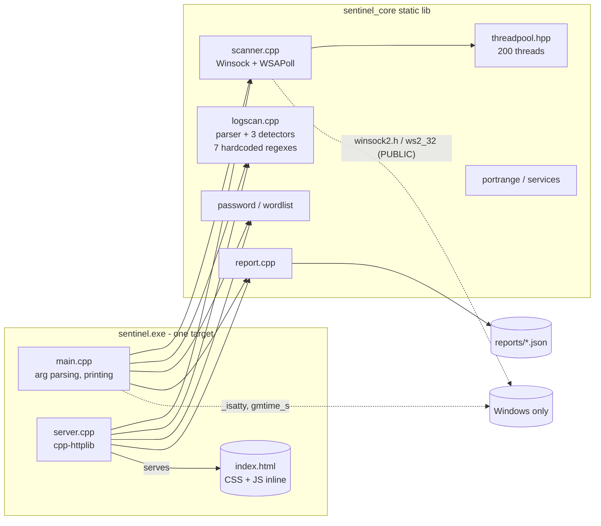
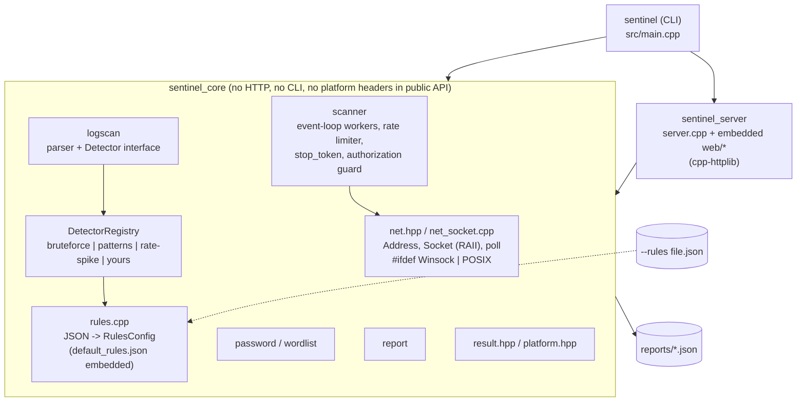

# Sentinel architecture review (v1.0.0 -> v1.1.0)

Scope: whole repository at tag `v1.0.0` (about 3,300 lines, 48 tests). The goal is "portfolio scale, current best practice": no rewrite, fix what is structurally wrong, document what is deliberately left alone. Every finding below was checked against the code (and, where stated, reproduced), not taken from the original builder's notes.

## 1. Architecture at v1.0.0

What was already good: the dependency direction is right (core never includes CLI or HTTP code), the server binds to `127.0.0.1`, validates `Host`/`Origin`/`Content-Type`, caps body size and serializes scans, the report loader whitelists file names, and there was a decent unit-test base for the parsers and detectors.

## 2. Findings

Severity: **High** = correctness/safety/portability defect with real impact; **Medium** = structural weakness that blocks maintenance or extension; **Low** = polish. "Status" is the outcome in v1.1.0.

| ID | Sev | Issue | Why it matters | Fix / status |
|---|---|---|---|---|
| A1 | High | **The responsible-use guard is bypassable and lives only in the CLI.** `is_loopback_host()` accepted any string starting with `127.`, so `127.evil.example.com` (which resolves to a public address) passed as "loopback". `run_scan()` itself had no check, so any library caller or future route could scan anything. | The one safety promise of the tool (non-loopback needs `--authorized`) did not hold. | `is_loopback_host` now only accepts `localhost` or a loopback IP *literal*; `run_scan` re-checks the **resolved** address and returns `Errc::Unauthorized` unless `ScanOptions::authorized`. The dashboard never sets it. Tests cover the prefix trick. **Fixed** |
| A2 | High | **Winsock code everywhere, no platform layer.** `winsock2.h` in `scanner.cpp` and in tests, `ws2_32` and `NOMINMAX/_WIN32_WINNT` as PUBLIC properties of the core library, `_isatty`/`gmtime_s`/`localtime_s` in CLI, server and report code. Manual `WSAStartup` guard inside scanner. | The "core" library only builds on Windows; socket lifetime is hand-managed; platform macros leak to every consumer. | New `sentinel/net.hpp`: `Address`, RAII move-only `Socket`, `poll()`, `Result`-based API, no platform header in any public header. One implementation file with `#ifdef _WIN32` (Winsock, `select`) and POSIX (`poll`, `fcntl`). `platform.hpp` wraps time/tty. WSAStartup is a function-local RAII static. **Fixed** (POSIX path written but not compiled here, see Decisions) |
| A3 | High | **IPv4 only.** `hints.ai_family = AF_INET`; `sockaddr_in` stored directly. | `::1` and dual-stack hosts cannot be scanned; localhost may resolve to `::1` first. | `Address` holds a `sockaddr_storage`-sized buffer; `--family auto|4|6`; Auto prefers IPv4; loopback test covers `::1`, `::ffff:127.x`. **Fixed** |
| B1 | Medium | **Concurrency model: one blocking `WSAPoll` per socket, 200-thread pool by default.** Verified: the connect is already non-blocking, but each thread watches exactly one socket, so concurrency == thread count. A closed loopback port on Windows is only reported after the stack's SYN retries (observed 0.5-2 s), so the threads mostly sleep. `ThreadPool` also swallowed all exceptions (`catch (...) {}`) and had no cancellation. | 200 threads for 200 sockets; scan speed capped by thread count; a failure in a worker disappeared silently; a running scan could not be stopped. | Scanner rewritten as a small event loop: 4 worker threads (default), each multiplexing up to `concurrency/threads` non-blocking sockets via `select()`/`poll()`, per-socket deadlines, banner phase in the same loop. Token-bucket rate limiter with burst allowance (needed on Windows' 15 ms timer tick). `std::stop_token` cancellation, worker exceptions converted to `Error`. `ThreadPool` deleted (no remaining user). Default 1024-port scan: 1.5 s; 65,535 ports with 1024 in flight: 20 s. **Fixed** |
| B2 | Medium | **Mixed error handling.** `run_scan` threw `runtime_error`, `parse_port_ranges` throws `invalid_argument`, `save_report` throws, detectors return values, server swallowed with `catch (...)`. | Callers cannot tell which functions throw; exceptions crossed the library boundary unannounced. | `sentinel::Result<T>` (C++20 stand-in for `std::expected`), `Error{message, Errc}`. Scanner, net layer, rules, detector registry and `analyze_log(rules)` return `Result`. CLI/server translate to exit codes / HTTP statuses. **Fixed** for everything that can fail at runtime; see Decisions for what still throws |
| C1 | Medium | **Detection rules hardcoded.** Seven regexes, severities and thresholds compiled into `logscan.cpp`; detectors were three free functions glued together in `analyze_log`. | Cannot tune or extend without recompiling; no extension point. | `Detector` interface + `DetectorRegistry` (id -> factory); built-ins `bruteforce`, `patterns`, `rate-spike`. Rules live in `rules/default_rules.json` (embedded into the binary, also installed) and can be overridden with `--rules FILE` (CLI and `serve`). Strict validation: types, ranges, severities, duplicate ids, regex compile check, regex length cap, file size cap. **Fixed** |
| C2 | Medium | **Unbounded regex input.** `std::regex` ran over full URL-decoded paths of arbitrary length (the server accepts 5 MB bodies). | `std::regex` is recursive/backtracking; a long crafted line can burn CPU or the stack. | Matched text is truncated to 4096 bytes; rule regexes capped at 1000 chars. Remaining risk with user-supplied rules is documented. **Mitigated** |
| D1 | Medium | **Dashboard CSP allowed `'unsafe-inline'`** for script and style because the page was a single file with inline `<style>`, `<script>` and `style=""` attributes. | Defeats the point of the CSP: any HTML injection becomes script execution. | Page split into `index.html`, `app.css`, `app.js` (all embedded, served same-origin); inline `style=` attributes replaced by classes; CSP is now `script-src 'self'; style-src 'self'` with no `unsafe-inline`. Verified in a real browser (no console errors, all tabs work). **Fixed** |
| D2 | Medium | **Core/server/CLI were one build graph, one executable.** HTTP server and embedded web assets were compiled straight into `sentinel`; no way to build or link the library without cpp-httplib. | Weak separation; server not testable in isolation. | Three targets with one-way dependencies: `sentinel_core` (no HTTP, no CLI) <- `sentinel_server` (httplib + web assets) <- `sentinel` (CLI). `SENTINEL_BUILD_SERVER=OFF` builds without httplib. `run_server(opts, stop_token)` is now callable from tests (ephemeral port, `on_ready`). **Fixed** |
| D3 | Medium | **Server: no cancellation, no timeouts.** A running scan blocked shutdown; no read/write timeout on connections. | Slow clients tie up threads; Ctrl+C/`--max-seconds` waited for scans. | Scans receive the server's `stop_token`; 10 s read/write timeouts; keep-alive cap. **Fixed** |
| D4 | Low | Server only checked `Origin`, not `Sec-Fetch-Site`; checks ran before the request body was read (clients could see a connection reset instead of the 403 - found by a flaky new test). | Defense in depth; deterministic client-visible errors. | `Sec-Fetch-Site` must be `same-origin`/`none` when present; POST checks moved into a `guard_post` wrapper that runs after the body is read; `Host` check stays in the pre-routing hook. Added `Cross-Origin-Resource-Policy/Opener-Policy`. **Fixed** |
| E1 | Medium | **CMake structure.** Warning flags copy-pasted per target, `/W4 /WX` only for MSVC (nothing for GCC/Clang), global compile definitions leaking to consumers, no `install()`, no presets, no options, `cmake_minimum_required 3.20`. | Hard to consume or build elsewhere. | `sentinel_warnings` INTERFACE target (MSVC and GCC/Clang flags), linked privately; modern `target_*` usage with BUILD/INSTALL interfaces; options `SENTINEL_BUILD_TESTS/SERVER/INSTALL`; `install()` for libs, CLI, headers, default rules, samples, docs plus an exported `Sentinel` CMake package (`sentinel::core`, `sentinel::server`); `CMakePresets.json` (Windows VS 2022, Linux Ninja). Install + `find_package(Sentinel)` consumer verified. **Fixed** |
| E2 | Medium | **No LICENSE file.** | Code cannot legally be reused. | MIT `LICENSE` added and installed. **Fixed** |
| F1 | Medium | **Test gaps.** Nothing for the server (CSP, Host/Origin/CSRF, size limit), cancellation, rate limiting, guard bypass, rule loading, registry, or socket-level behaviour; scanner tests used raw Winsock. | The risky parts were the untested ones. | 39 new tests (48 -> 87): net layer, `Result`, rules loader/validation, registry/custom detector, scanner guard/cancel/rate/IPv6/concurrency, in-process server tests over HTTP. **Fixed** |
| G1 | Low | `save_report` did not check that the write succeeded. | A full disk produced an empty report and success. | Stream state is checked and an exception is raised (callers already catch it). **Fixed** |
| G2 | Low | `report.hpp` includes `<nlohmann/json.hpp>` in a public header. | Consumers must have nlohmann_json. | Left; the exported package config does `find_dependency(nlohmann_json)`. |
| G3 | Low | `parse_port_ranges` throws `std::invalid_argument`. | Inconsistent with `Result`. | Left on purpose: pure input parsers, documented, caught at both entry points (CLI `main`, server handler). |
| G4 | Low | Hand-written argument parser in `main.cpp`. | Fine at this size; a CLI library would add a dependency for little. | Left. |
| G5 | Low | Dashboard API has no per-run token; any local process or local user can call `127.0.0.1:port`. | Only matters on shared machines. | Left; documented. Host/Origin/Sec-Fetch checks stop browser-based attacks, which is the realistic threat. |
| G6 | Low | Best-effort zeroing of password buffers (`std::fill`) may be optimised away. | Passwords are never stored or logged anyway. | Left. |
| G7 | Low | `getaddrinfo` has no timeout. | A dead resolver can stall `scan --host name`. | Left (loopback is the default target). |

## 3. Architecture at v1.1.0

Dependency direction: `sentinel` -> `sentinel_server` -> `sentinel_core`; core never includes server or CLI code. Platform-specific code is confined to `src/net_socket.cpp` and `src/platform.cpp`.

## 4. Decisions

**Changed**
- Introduced a socket abstraction instead of adopting Asio/Boost: the scanner needs ~10 socket operations, a 300-line layer is cheaper than a dependency and keeps the build to three FetchContent packages.
- `select()` on Windows rather than `WSAPoll`: `WSAPoll` historically did not report failed non-blocking connects, which would turn every closed port into a full timeout. `FD_SETSIZE` is raised to 1024 inside that one translation unit; `poll()` accepts at most 1000 entries per call.
- `--threads` now means "event-loop workers" (default 4, clamped to 64). Old command lines such as `--threads 200` still work; `--concurrency` (default 512, max 1024) controls how many connections are in flight.
- A project-local `Result<T>` instead of `std::expected`, because the project is C++20.
- Rules replace, not merge: a `patterns` array in a rules file replaces the default list (documented in `rules.hpp`); thresholds and `enabled` flags fall back to defaults when omitted. CLI flags (`--bf-threshold`, ...) override the rules file.
- `DetectorConfig` and the old `analyze_log(in, DetectorConfig, year)` overload were kept so existing callers and tests keep working.

**Intentionally left**
- Closed-port latency on Windows (SYN retransmissions, up to ~2 s for a refused loopback connect) is operating-system behaviour. It is hidden by concurrency, not eliminated; the per-probe timeout still bounds it.
- No TLS/auth on the dashboard (loopback only, see G5).
- `std::regex` stays: rules are ECMAScript patterns that users can read, input is length-capped, and swapping in RE2 would add a dependency. A pathological user-supplied rule can still be slow; rules files are trusted input.
- POSIX implementation is written against the same interface but **was not compiled in this environment** (no Linux toolchain or WSL distribution available). The Windows build, tests and smoke runs are the verified configuration; a Linux CI job is the obvious next step and the presets for it exist.
- No async DNS, no UDP scanning, no SYN scan: out of scope for a defensive portfolio tool.
