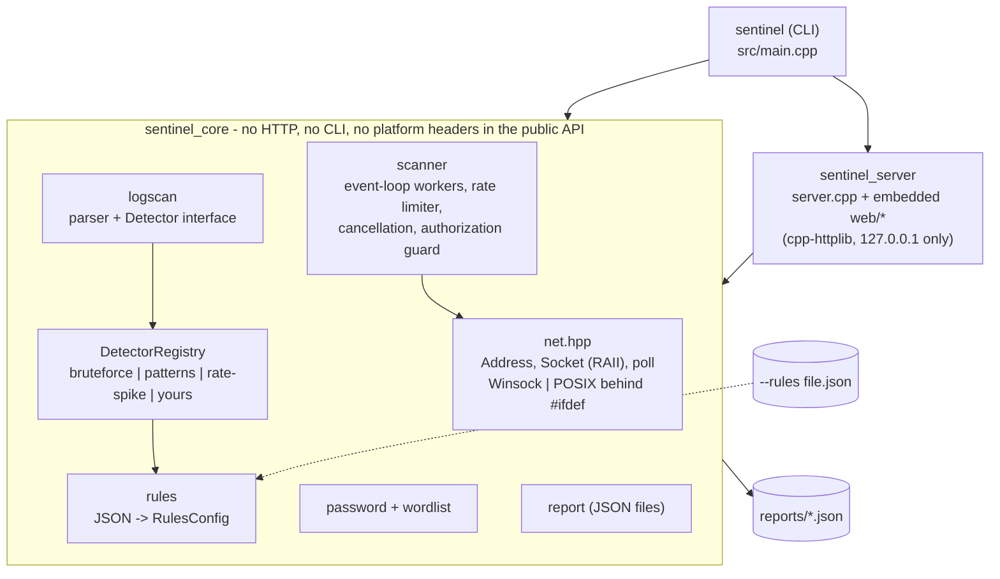

# Sentinel

Sentinel is a small defensive security toolkit written in C++20. It helps you check **your own** machine and logs: scan local ports, find attacks in logs, and audit password strength. It ships as a library, a CLI (`sentinel`), and a local web dashboard (`sentinel serve`). Windows is the verified platform; the socket layer also has a POSIX implementation (see [ARCHITECTURE_REVIEW.md](ARCHITECTURE_REVIEW.md)).

> **Responsible use.** Only scan hosts and networks that you own or are explicitly authorized to test. Unauthorized scanning can be illegal and may disrupt services. Sentinel defaults to `127.0.0.1`, refuses non-loopback targets unless you pass `--authorized` (the check is enforced in the library on the *resolved* address, not just in the CLI), rate-limits connection attempts, and the dashboard can only scan the local machine. Password candidates are scored in memory and are never stored, logged, or echoed back.

## Features

| Command | What it does |
|---|---|
| `scan` | TCP connect scanner (IPv4 and IPv6): a few worker threads each multiplex hundreds of non-blocking sockets with `select()`/`poll()`; configurable ports (`1-1024`, `22,80,8000-8100`, `common`), timeout, rate limit, banner grabbing, service-name guess. |
| `logscan` | Parses sshd/syslog auth logs and Apache/nginx combined access logs. Pluggable detectors: brute force (N failed logins per IP in a window, plus "success after brute force"), SQLi / XSS / path-traversal / command-injection / recon probes (regex rules on URL-decoded paths), and request-rate spikes (z-score over per-minute buckets). Rules and thresholds come from [`rules/default_rules.json`](rules/default_rules.json) and can be overridden with `--rules`. |
| `audit` | Password-strength auditor: entropy estimate with penalties for repeats, sequences, keyboard walks and trailing years, bundled common-password list (leetspeak-aware, optional extra wordlist), 0-4 score, feedback, offline crack-time estimate. |
| `serve` | Local dashboard on `127.0.0.1`: run a scan, paste/upload a log, live password meter, report history. Light/dark theme, responsive, keyboard accessible. |

All commands support `--json` and save a report to `reports/` (use `--no-save` to skip, `--report-dir` to relocate).

## Architecture



Dependencies point one way: `sentinel` -> `sentinel_server` -> `sentinel_core`. Fallible core functions return `sentinel::Result<T>` (`include/sentinel/result.hpp`) instead of throwing; exceptions are caught at the CLI and HTTP boundaries.

```
include/sentinel/   public headers (net, scanner, logscan, rules, password, report, server, result, ...)
src/                core implementation; net_socket.cpp is the only place with socket #ifdefs
src/server.cpp      dashboard HTTP server (library sentinel_server)
src/main.cpp        CLI
rules/              default_rules.json (embedded into the binary at build time, also installed)
web/                index.html + app.css + app.js, embedded and served same-origin (no inline script/style)
cmake/              embed.cmake (asset embedding), version.hpp.in, package config template
samples/            sample auth.log, access.log, passwords.txt
tests/              GoogleTest suites (net, scanner, rules/registry, parsers, passwords, server)
```

### Writing a rules file

```json
{
  "bruteforce": { "enabled": true, "threshold": 3, "window_seconds": 120 },
  "rate_spike": { "enabled": false },
  "patterns": [
    { "id": "admin-probe", "type": "recon", "label": "Admin probe",
      "severity": "low", "regex": "/admin" }
  ]
}
```

Omitted sections keep the defaults; a `patterns` array replaces the default pattern list. Severities: `info`, `low`, `medium`, `high`, `critical`. Invalid files are rejected with a message naming the offending rule. Use it with `sentinel logscan --rules my.json access.log` or `sentinel serve --rules my.json`.

### Adding a detector

Implement `sentinel::Detector` (`id()` and `analyze(span<const LogEntry>)`), register a factory on a `DetectorRegistry`, and pass the registry to `analyze_log(in, rules, year, registry)`.

## Build

Requirements: CMake 3.21+, a C++20 compiler (Visual Studio 2022 Build Tools are enough on Windows), git. Dependencies (nlohmann/json, cpp-httplib, GoogleTest) are fetched with CMake FetchContent on first configure.

```
cmake --preset windows-msvc
cmake --build --preset windows-release
```

Without presets: `cmake -S . -B build -G "Visual Studio 17 2022" -A x64` and `cmake --build build --config Release`. On Linux/macOS use the `linux-release` preset (Ninja). Options: `SENTINEL_BUILD_TESTS`, `SENTINEL_BUILD_SERVER` (set `OFF` to build the library and CLI without cpp-httplib), `SENTINEL_INSTALL`.

All Sentinel targets link the `sentinel_warnings` interface target (`/W4 /WX` on MSVC, `-Wall -Wextra -Wpedantic -Werror` elsewhere).

## Test

```
ctest --preset windows-release
```

## Install / use as a library

```
cmake --install build/windows-msvc --config Release --prefix <dir>
```

```cmake
find_package(Sentinel 1.1 REQUIRED)            # also needs nlohmann_json
target_link_libraries(app PRIVATE sentinel::core)   # sentinel::server for the dashboard
```

## Run

```
build\windows-msvc\Release\sentinel --version
build\windows-msvc\Release\sentinel scan                          :: 127.0.0.1, ports 1-1024
build\windows-msvc\Release\sentinel scan --ports common --json
build\windows-msvc\Release\sentinel scan --host ::1 --family 6
build\windows-msvc\Release\sentinel logscan samples\auth.log samples\access.log
build\windows-msvc\Release\sentinel logscan samples\access.log --rules my-rules.json
build\windows-msvc\Release\sentinel audit samples\passwords.txt
type samples\passwords.txt | build\windows-msvc\Release\sentinel audit --json
build\windows-msvc\Release\sentinel serve --port 8787             :: open http://127.0.0.1:8787/
```

Useful options: `scan --timeout 500 --threads 4 --concurrency 512 --rate 1000 --no-banner --family auto|4|6`, `logscan --rules F --bf-threshold 5 --bf-window 300 --z 3.0 --year 2024`, `audit --wordlist mylist.txt`, `serve --max-seconds 60 --rules F`. Run `sentinel --help` for the full list. (`--threads` counts event-loop workers; old values such as `--threads 200` still work, clamped to 64.)

### Dashboard security notes

The server binds to loopback only, validates the `Host` header (DNS-rebinding protection), and for POSTs checks `Origin`, `Sec-Fetch-Site` and `Content-Type: application/json` (CSRF). It caps request size, applies read/write timeouts, only scans `127.0.0.1`, allows one scan at a time, and serves a strict CSP with no `unsafe-inline` (the page is `index.html` + `app.css` + `app.js`, all same-origin).

## License

MIT, see [LICENSE](LICENSE).
