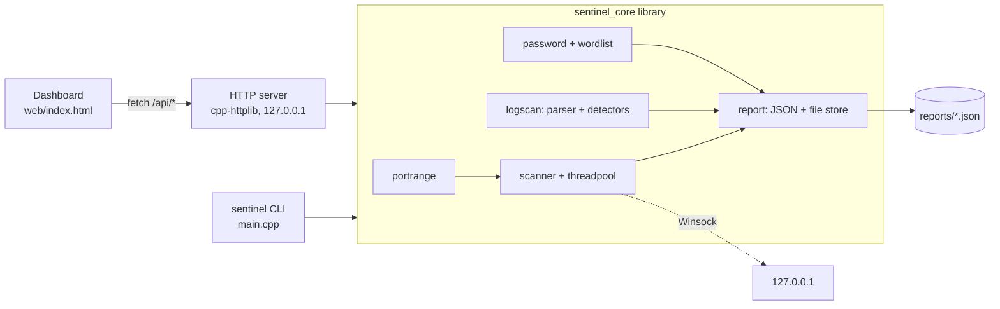

# Sentinel

Sentinel is a small defensive security toolkit written in C++20 for Windows. It helps you check **your own** machine and logs: scan local ports, find attacks in logs, and audit password strength. It ships as a library, a CLI (`sentinel`), and a local web dashboard (`sentinel serve`).

> **Responsible use.** Only scan hosts and networks that you own or are explicitly authorized to test. Unauthorized scanning can be illegal and may disrupt services. Sentinel defaults to `127.0.0.1`, refuses non-loopback targets unless you pass `--authorized`, rate-limits connection attempts, and the dashboard can only scan the local machine. Password candidates are scored in memory and are never stored, logged, or echoed back.

## Features

| Command | What it does |
|---|---|
| `scan` | Multithreaded TCP connect scanner: thread pool, non-blocking Winsock sockets, configurable ports (`1-1024`, `22,80,8000-8100`, `common`), timeout and rate limit, banner grabbing, service-name guess. |
| `logscan` | Parses sshd/syslog auth logs and Apache/nginx combined access logs. Detects brute force (N failed logins per IP in a window, plus "success after brute force"), SQLi / XSS / path-traversal / command-injection / recon probes (regex on URL-decoded paths, double encoding handled), and request-rate spikes (z-score over per-minute buckets). Findings carry a severity (`info` ... `critical`). |
| `audit` | Password-strength auditor: entropy estimate with penalties for repeats, sequences, keyboard walks and trailing years, bundled common-password list (leetspeak-aware, optional extra wordlist), 0-4 score, feedback, offline crack-time estimate. |
| `serve` | Local dashboard on `127.0.0.1`: run a scan, paste/upload a log, live password meter, report history. Light/dark theme, responsive, keyboard accessible. |

All commands support `--json` and save a report to `reports/` (use `--no-save` to skip, `--report-dir` to relocate).

## Architecture



```
include/sentinel/   public headers of the core library
src/                core implementation, CLI (main.cpp), HTTP server (server.cpp)
web/index.html      dashboard, embedded into the binary at configure time (cmake/embed.cmake)
samples/            sample auth.log, access.log, passwords.txt
tests/              GoogleTest suites (port ranges, log parser/detectors, passwords, scanner)
```

## Build

Requirements: Windows, CMake 3.20+, Visual Studio 2022 (Build Tools are enough), git. Dependencies (nlohmann/json, cpp-httplib, GoogleTest) are fetched with CMake FetchContent on first configure.

```
cmake -S . -B build -G "Visual Studio 17 2022" -A x64
cmake --build build --config Release
```

The build uses `/W4 /WX` on Sentinel's own targets.

## Test

```
ctest --test-dir build -C Release --output-on-failure
```

## Run

```
build\Release\sentinel --version
build\Release\sentinel scan                          :: 127.0.0.1, ports 1-1024
build\Release\sentinel scan --ports common --json
build\Release\sentinel logscan samples\auth.log samples\access.log
build\Release\sentinel audit samples\passwords.txt
type samples\passwords.txt | build\Release\sentinel audit --json
build\Release\sentinel serve --port 8787             :: open http://127.0.0.1:8787/
```

Useful options: `scan --timeout 500 --threads 200 --rate 1000 --no-banner`, `logscan --bf-threshold 5 --bf-window 300 --z 3.0 --year 2024`, `audit --wordlist mylist.txt`, `serve --max-seconds 60`. Run `sentinel --help` for the full list.

### Dashboard security notes

The server binds to loopback only, validates the `Host` and `Origin` headers (DNS-rebinding/CSRF protection), requires `Content-Type: application/json` on POSTs, caps request size, serves a strict CSP, only scans `127.0.0.1`, and allows one scan at a time.

